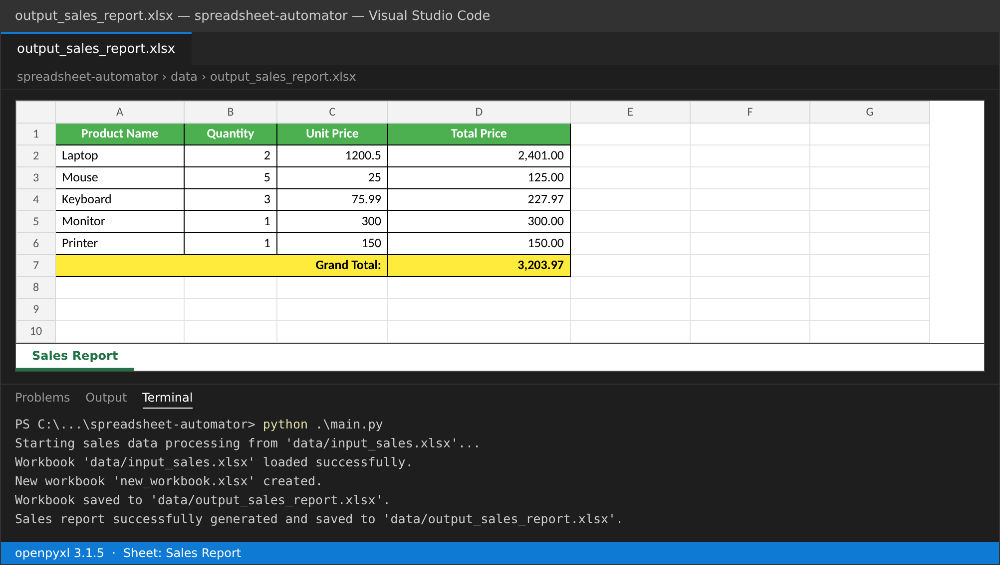

# Lab Week 10: Automating Spreadsheets (Excel & Google Sheets)

SP352301 Script Programming — ภาคเรียน 1/2569

โปรเจกต์นี้ใช้ Python กับไลบรารี `openpyxl` อ่านข้อมูลยอดขายจากไฟล์ Excel (`.xlsx`) คำนวณราคารวมต่อรายการและยอดรวมทั้งหมด แล้วเขียนรายงานลงไฟล์ Excel ใหม่พร้อมจัดรูปแบบ

## Key Concepts Demonstrated

* **`openpyxl`** — อ่าน เขียน และแก้ไขไฟล์ `.xlsx`
* **Workbook & Worksheet** — `load_workbook()`, `Workbook()`, `wb.active`, `create_sheet()`, ลบ sheet เริ่มต้น, `save()`
* **Cell Manipulation** — อ่าน/เขียนค่าด้วย `sheet.cell(row=, column=)`
* **Iterating Rows** — `iter_rows(min_row=2, values_only=True)` พร้อมข้ามแถวว่าง
* **Data Processing** — Total Price = Quantity × Unit Price และ Grand Total
* **Formatting** — ตัวหนา สีพื้นหัวตาราง (เขียว) แถวรวม (เหลือง) เส้นขอบ จัดตำแหน่ง `number_format = '#,##0.00'`
* **Merge Cells** — รวมเซลล์ A:C ในแถว Grand Total
* **Column Width** — ปรับความกว้างคอลัมน์ตามความยาวข้อมูล

## Setup & How to Run

```bash
git clone https://github.com/sarid101/spreadsheet-automator.git
cd spreadsheet-automator
pip install openpyxl
python main.py
```

ถ้ายังไม่มีไฟล์ `data/input_sales.xlsx` ให้รัน `python create_input.py` ก่อน สคริปต์จะสร้างไฟล์ตัวอย่างให้

### ข้อมูล input (`data/input_sales.xlsx`, Sheet1)

| Product Name | Quantity | Unit Price |
| :----------- | -------: | ---------: |
| Laptop       | 2        | 1200.50    |
| Mouse        | 5        | 25.00      |
| Keyboard     | 3        | 75.99      |
| Monitor      | 1        | 300.00     |
| *(แถวว่าง)*  |          |            |
| Printer      | 1        | 150.00     |

มีแถวว่างหนึ่งแถวตามที่ Lab กำหนด เพื่อทดสอบว่าสคริปต์ข้ามแถวว่างได้

### ผลลัพธ์ (`data/output_sales_report.xlsx`, sheet "Sales Report")

| Product Name | Quantity | Unit Price | Total Price |
| :----------- | -------: | ---------: | ----------: |
| Laptop       | 2        | 1200.5     | 2,401.00    |
| Mouse        | 5        | 25         | 125.00      |
| Keyboard     | 3        | 75.99      | 227.97      |
| Monitor      | 1        | 300        | 300.00      |
| Printer      | 1        | 150        | 150.00      |
| **Grand Total:** |      |            | **3,203.97** |

### ผลการรันใน Terminal

```
Starting sales data processing from 'data/input_sales.xlsx'...
Workbook 'data/input_sales.xlsx' loaded successfully.
New workbook 'new_workbook.xlsx' created.
Workbook saved to 'data/output_sales_report.xlsx'.
Sales report successfully generated and saved to 'data/output_sales_report.xlsx'.
```

## Screenshot



## Project Structure

```
spreadsheet-automator/
├── src/
│   ├── __init__.py              # Python package marker
│   └── excel_processor.py       # คลาส ExcelProcessor: load / create / process / save
├── data/
│   ├── input_sales.xlsx         # ไฟล์ข้อมูลขาย (input)
│   └── output_sales_report.xlsx # สร้างโดยสคริปต์ (อยู่ใน .gitignore)
├── screenshots/
│   └── output_sales_report.png  # ภาพผลลัพธ์
├── create_input.py              # สคริปต์สร้างไฟล์ input ตัวอย่าง
├── main.py                      # จุดเริ่มต้นโปรแกรม
├── lab_week10_colab.ipynb       # Notebook สำหรับรันบน Google Colab
├── .gitignore
└── README.md
```

## หมายเหตุการแก้โค้ดจากต้นฉบับ

* `main.py` ใช้ `os.path.abspath(__file__)` และ `os.chdir()` ไปที่โฟลเดอร์โปรเจกต์ก่อน ทำให้หาไฟล์ใน `data/` เจอแม้จะรันจากโฟลเดอร์อื่น
* เปลี่ยน `except:` เปล่าในส่วนปรับความกว้างคอลัมน์เป็นการเช็ก `cell.value is not None` แทน
* เพิ่ม `create_input.py` เพื่อสร้าง `input_sales.xlsx` ด้วยโค้ด (Lab ให้สร้างเองหรือสร้างด้วยสคริปต์ก็ได้)
* เพิ่ม `~$*.xlsx` ใน `.gitignore` กันไฟล์ lock ที่ Excel สร้างตอนเปิดไฟล์ค้างไว้

## Debugging Spreadsheet Automation

* **`FileNotFoundError`** — ตรวจว่ามี `data/input_sales.xlsx` และชื่อไฟล์ตรงกัน
* **`InvalidFileException`** — `openpyxl` อ่านได้เฉพาะ `.xlsx` ไม่รองรับ `.xls` แบบเก่า
* **`PermissionError` ตอน save** — ปิดไฟล์ `output_sales_report.xlsx` ใน Excel ก่อนรันใหม่
* **`ValueError` / `TypeError`** — Quantity หรือ Unit Price ไม่ใช่ตัวเลข สคริปต์จะพิมพ์ Warning และข้ามแถวนั้น
* **ลำดับคอลัมน์ผิด** — สคริปต์อ่านตามตำแหน่ง A=Product Name, B=Quantity, C=Unit Price

## Google Sheets (แนวคิด)

ใช้ Google Sheets API ผ่านไลบรารี `gspread` ได้ ต้องสร้าง Service Account บน Google Cloud และแชร์ชีตให้อีเมลของ Service Account ก่อน (ยืนยันตัวตนด้วย OAuth 2.0 / ไฟล์ key JSON ซึ่งห้าม push ขึ้น GitHub) ข้อต่างจาก `openpyxl` คือทำงานกับไฟล์บนคลาวด์ผ่านอินเทอร์เน็ต แทนไฟล์ในเครื่อง
